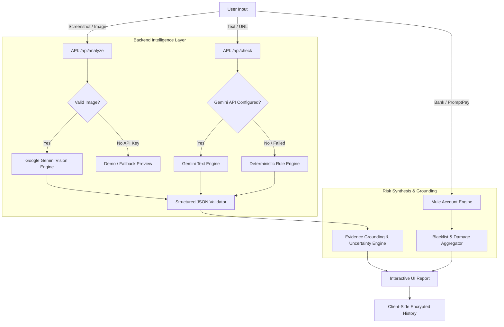

# 🛡️ ScamLens — AI-Powered Scam & Fraud Intelligence

> **Harddisk Team — U-Hackathon 2026**  
> *"Predict Before It Gets Reported"* — An uncertainty-aware, multimodal fraud detection platform protecting Thai and global users from digital scams.

---

## 📌 Executive Summary

Digital fraud and online scams have surged dramatically—costing billions annually through SMS phishing, fake courier messages, government/police impersonation, and mule bank accounts. Everyday victims lack cybersecurity expertise to recognize deceptive patterns before it's too late.

**ScamLens** is an end-to-end intelligent security companion built to bridge this gap. By combining multimodal Large Language Models (Gemini Vision) with deterministic threat rules and real-time blacklists, ScamLens allows users to simply **upload a screenshot**, **paste a link or text message**, or **check a bank account** to receive an instant, explainable risk assessment with concrete actionable advice.

---

## ✨ Key Features

### 1. 📸 Multimodal Screenshot Risk Scanner (`/`)
- **Visual & Textual Evidence Extraction:** Upload or drag-and-drop screenshots of SMS messages, LINE chats, fake delivery alerts, banking notifications, or social media offers.
- **Uncertainty-Aware Risk Scoring:** Computes a risk score (0–100) and categorizes threats into `Low`, `Medium`, `High`, or `Uncertain` with transparent caveats.
- **Exact Evidence Grounding:** Quotes exact suspicious phrases visible in the image to show *why* it is dangerous (e.g., urgency cues, credential theft requests, suspicious URLs).
- **Actionable Next Steps:** Direct safety recommendations (e.g., "Do not click link", "Contact bank immediately via 1441").

### 2. 🔗 Text & URL Rapid Inspector (`/check`)
- **Direct Link & SMS Verification:** Analyze raw text messages and suspicious domain names.
- **Dual Engine Pipeline:** Leverages Google Gemini AI with seamless automatic fallback to a deterministic regex & heuristic pattern engine.
- **Deception Analysis:** Detects subdomain spoofing, misleading TLDs (`.xyz`, `.top`, `.vip`), `@` userinfo deception, and impersonation keywords.

### 3. 🏦 Mule Bank & PromptPay Checker (`/bank-check`)
- **Blacklist & Watchlist Lookup:** Search bank account numbers, PromptPay IDs, or citizen names against community and official scam reports.
- **Victim & Loss Metrics:** View aggregated reports, incident counts, total estimated damages, and scam categories (e.g., Online Marketplace Fraud, Crypto Task Scam).
- **Crowdsourced Reporting:** Community members can submit verified evidence of fraud to protect future potential victims.

### 4. 📜 Privacy-Preserving Scan History (`/history`)
- **Local-First Privacy:** Scan history is saved strictly client-side via browser `localStorage`—no sensitive screenshots or chat messages are retained on central databases.
- **Sanitized Export:** Download audit logs as JSON or CSV with formula-injection sanitization (`=`, `+`, `-`, `@`).

### 5. 🚨 Safety Guide & Emergency Hotlines (`/guide`)
- Direct access to essential Thai authorities and fraud response teams:
  - **AOC 1441** (Anti-Online Scam Operation Center — 24/7 Hotline)
  - **Thai Police Online** (`thaipoliceonline.go.th`)
  - **NBTC 1200** (Telecom & SMS spam complaints)
  - Major Thai commercial banks' 24/7 fraud reporting lines.

---

## ⚙️ How It Works (System Architecture)

### High-Level Workflow



### Multimodal Pipeline Detail
1. **Intake & Pre-Validation:** Images are validated for MIME type (`image/png`, `image/jpeg`, `image/webp`) and size limits (< 10MB) to protect against memory exhaustion.
2. **Vision Analysis (Gemini):** System instructions enforce strict isolation rules: untrusted content inside screenshots cannot execute prompt injections. Evidence quotes are mapped directly to specific warning categories.
3. **Structured Response Contract:** Outputs adhere strictly to a standardized TypeScript schema (`ScamAnalysis`), ensuring zero UI crashes even on complex inputs.

---

## 🔮 Future Roadmap: Combining with Custom Machine Learning Models

While the current MVP uses Large Language Models (LLMs) and heuristic engines, our target architecture transitions into a **hybrid, production-grade ML intelligence platform**:

```
[ User Input / Stream ]
         │
         ▼
┌─────────────────────────────────────────────────────────────┐
│ 1. Specialized Thai NLP Model (WangchanBERTa / RoBERTa)     │
│    - Fine-tuned on Thai scam corpora (SMS, LINE, Facebook)   │
│    - Intent & urgency classification with sub-50ms latency │
└────────────────────────┬────────────────────────────────────┘
                         │
                         ▼
┌─────────────────────────────────────────────────────────────┐
│ 2. Feature-Engineered URL Classifier (XGBoost / LightGBM)   │
│    - Lexical entropy, brand distance (Levenshtein), WHOIS   │
│    - Real-time Tree SHAP interpretability scores            │
└────────────────────────┬────────────────────────────────────┘
                         │
                         ▼
┌─────────────────────────────────────────────────────────────┐
│ 3. ScamGraph: Relational Graph Neural Network (GNN)         │
│    - Link bank accounts, phone numbers, and domains         │
│    - Cluster & uncover syndicated criminal mule rings        │
│    - "Predict Before It Gets Reported"                      │
└────────────────────────┬────────────────────────────────────┘
                         │
                         ▼
┌─────────────────────────────────────────────────────────────┐
│ 4. Multimodal Fusion & Local Client Inference (ONNX)       │
│    - On-device edge scanning for zero-privacy leaks         │
│    - Hybrid score fusion combining LLM + ML model weights   │
└─────────────────────────────────────────────────────────────┘
```

### Planned ML Upgrades:
1. **Fine-Tuned Thai Fraud Transformer (WangchanBERTa):**
   - Fine-tuned on classified real-world Thai scam templates (e.g., fake Revenue Department tax refund apps, loan approval fees, task-based investment scams).
   - Drastically cuts API latency and operational cost compared to general LLMs.

2. **XGBoost URL Risk Classifier with Tree SHAP:**
   - 40+ lexical and structural features (subdomain depth, brand spoofing Levenshtein distance, IP entropy, age of domain via WHOIS).
   - Generates exact feature importance charts (SHAP values) so users see exactly why a link was flagged.

3. **Graph Neural Network (ScamGraph Engine):**
   - Treats phone numbers, PromptPay IDs, bank accounts, and URL hosts as nodes in a heterogeneous graph.
   - Using Node2Vec / GCN to detect syndicate clusters and predict mule accounts before victims report them.

4. **Edge / On-Device Inference via ONNX Runtime:**
   - Run lightweight models directly inside the user's browser or mobile device, ensuring personal chat conversations never leave the client device.

---

## 🛠️ Tech Stack

- **Framework:** Next.js 16 (App Router)
- **Language:** TypeScript
- **Styling:** Tailwind CSS & Vanilla CSS Design Tokens
- **AI / LLM:** Google GenAI SDK (`@google/genai`) — Gemini 3.5 Flash / Flash Lite
- **Icons:** Lucide React
- **Deployment:** Vercel (Edge & Serverless Ready)

---

## 🚀 Getting Started

### Prerequisites
- Node.js 18.x or 20.x
- npm, yarn, or pnpm
- (Optional) Google Gemini API Key (get one from [Google AI Studio](https://aistudio.google.com/))

### Installation

```bash
# 1. Clone repository
git clone https://github.com/your-org/Harddisk_Team_U-Hackathon_2026.git
cd Harddisk_Team_U-Hackathon_2026

# 2. Install dependencies
npm run install:all
# or: npm install --prefix webapp

# 3. Configure environment variables
cp webapp/.env.example webapp/.env.local
```

### Environment Configuration (`webapp/.env.local`)

```env
# Optional: If omitted, the app runs in Demo Mode with mocked threat samples
GEMINI_API_KEY=your_gemini_api_key_here

# Optional: Preferred model override (defaults to gemini-3.5-flash-lite)
GEMINI_MODEL=gemini-3.5-flash-lite
```

### Running Locally

```bash
npm start
# or: npm run dev
```

Open [http://localhost:3000](http://localhost:3000) in your browser.

---

## ☁️ Deployment (Vercel)

The repository is configured for 1-click deployment on **Vercel**:

1. Push your code to GitHub.
2. Import the repository into [Vercel](https://vercel.com).
3. Set **Root Directory** to `webapp` (or root, as `vercel.json` routes the build).
4. Add `GEMINI_API_KEY` under Environment Variables.
5. Click **Deploy**.

---

## 👥 Team & Hackathon Information

- **Team:** Harddisk Team
- **Hackathon:** U-Hackathon 2026
- **Branch:** `Develop/Chore`

---

## ⚠️ Disclaimer

*ScamLens is an AI-assisted decision-support tool designed for threat intelligence and educational awareness. An AI risk score of "Low" does not constitute an absolute guarantee of safety. Users should always exercise caution, never share banking OTPs, and verify official requests through direct institutional channels.*
